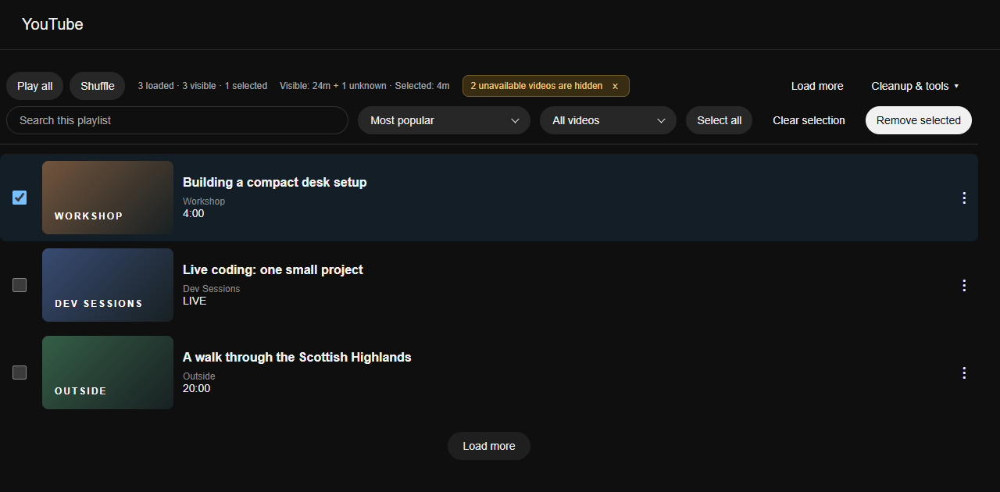
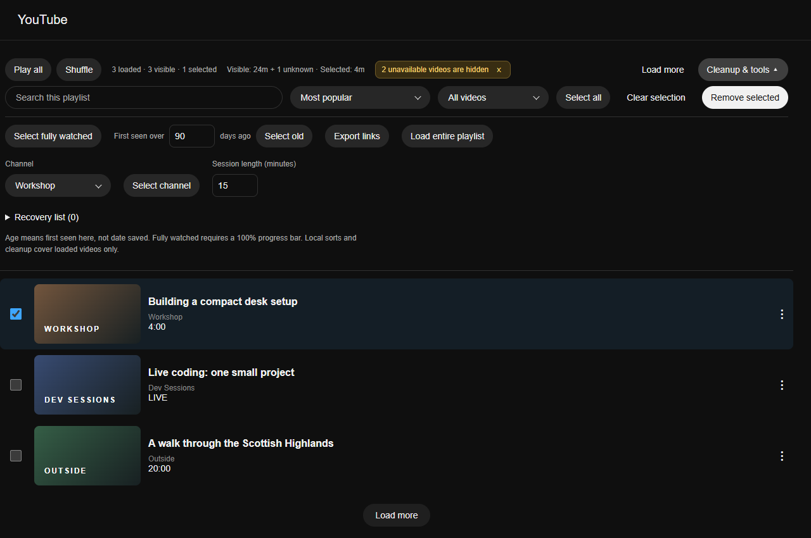

# Watch Later+

A cleaner YouTube Watch Later, for **Chrome and Firefox**.



_Preview with sample videos._

- Sort by popularity, published date, added date, title, channel or duration.
- Select videos with checkboxes and remove them in bulk.
- Clean up watched videos, old saves and individual channels.
- Filter by session length and see watch-time totals.
- Load the whole playlist and keep recovery links for removed videos.

<details>
<summary>See cleanup tools</summary>



</details>

## Install

**Chrome:** [Download the source](https://github.com/MattSG/watchlater-plus/archive/refs/heads/main.zip), unzip it, then open `chrome://extensions`. Enable **Developer mode**, click **Load unpacked**, and select the folder containing `manifest.json`.

**Firefox 142+:** Run `npm ci` and `npm run build`. Open `about:debugging#/runtime/this-firefox`, click **Load Temporary Add-on**, and select `dist/firefox/manifest.json`. Permanent installation needs Mozilla signing.

Open [Watch Later](https://www.youtube.com/playlist?list=WL). After updating, reload the extension and refresh YouTube.

Cleanup covers **loaded videos**. “Old” means first seen by the extension, not date saved. Recovery links let you add videos back manually. Native menus currently require English YouTube.

## Contribute

Node.js 22.13+:

```sh
npm ci
npm run validate
```

[Publishing & browser tests](PUBLISHING.md) · [Privacy](PRIVACY.md) · [MIT license](LICENSE)
